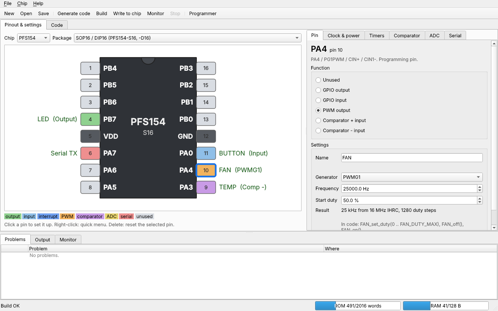

# Padauk Studio

A CubeMX-style tool for the Padauk **PMS150C**, **PFS154** and **PFS122**
microcontrollers. Click pins on a drawing of the chip, pick what they do, and
it writes the start-up C code. Then build with SDCC and write the chip with the
[Easy PDK programmer](https://github.com/free-pdk/easy-pdk-programmer-software),
all from one window.



It's one file with everything inside: SDCC 4.6.0, easypdkprog with native
PFS122 support (from the [PoGo430 fork](https://github.com/PoGo430/easy-pdk-programmer-software)),
the programmer firmware 1.4, dfu-util and the examples. Nothing else to install.

## Download and run

Get `padauk-studio` (Linux) or `padauk-studio.exe` (Windows) from the
[Releases](../../releases) page, or from the latest run on the
[Actions](../../actions) page (Artifacts).

```sh
chmod +x padauk-studio
./padauk-studio
```

Linux, once: to use the programmer without root, add yourself to the
`dialout` group and log in again:

```sh
sudo usermod -aG dialout $USER
```

## Using it

1. **File > New**: pick the chip, the package and an example (or an empty project).
2. **Set up pins**: click a pin on the drawing. The **Pin** page on the right
   shows what it can do; pick a function, give it a name (like `LED`) and
   settings. To clear a pin: choose **Unused**, press **Delete**, or
   right-click it. Nothing pops up in your way.
3. **Clock & power**, **Timers**, **Comparator**, **ADC** (PFS122) and
   **Serial** pages hold the rest. The **Problems** list checks everything as
   you go (clock too fast for the supply voltage, two pins on one PWM
   timer, ...). Double-click a problem to jump to it.
4. **Code** tab: write your program in `main.c` between the
   `USER CODE BEGIN` / `USER CODE END` lines. That code is kept when the
   settings change and the code is generated again. Or open the folder in VS
   Code (button on the Code tab).
5. **Build** (Ctrl+B) shows ROM and RAM use; errors are clickable.
   **Write to chip** (Ctrl+U) builds and writes the chip in the programmer
   (OTP chips ask first). **Monitor** (Ctrl+M) runs the chip in the
   programmer and shows what it prints with `serial_print()`.

### What the generated code gives you

For a pin named `LED` set as an output: `LED_high()`, `LED_low()`,
`LED_toggle()`, `LED_set(x)`, `LED_read()`. Inputs: `BUTTON_read()`. PWM
pins: `FAN_set_duty(v)` (0 .. `FAN_DUTY_MAX`), `FAN_off()`, `FAN_on()`. ADC
pins: `POT_read()` (0..4095) and `vdd_read_mv()`. Also `delay_ms()`,
`delay_us()`, `millis()` (Timer16), `comparator_read()`,
`serial_print()` / `serial_println()` / `serial_print_uint()` /
`serial_print_hex()`, and the interrupt handler with a section per source
(`irq_PA0`, `irq_T16`, `irq_TM2`, ...).

### Project folder

```
project.pdkstudio   the settings (JSON)
main.c              your code (only the USER CODE sections are yours)
pdk_init.c / .h     generated: clock, calibration, fuses, pins, timers, interrupts, helpers
pfs154.h            generated: the chip's registers and bits, from its datasheet
.clangd             generated: lets clangd (VS Code, Neovim, ...) read SDCC code
.vscode/            generated: the same for VS Code's C/C++ extension (IntelliSense)
build/              compiler output; build/<name>.ihx is what gets written
```

Extra `.c` files in the folder are compiled too.

### Examples

| Example | PMS150C | PFS154 | PFS122 |
|---|:-:|:-:|:-:|
| Blink, Blink with millis(), Button controls LED, Button interrupt, Sleep and wake up | ✓ | ✓ | ✓ |
| Serial: Hello World, Serial: button presses | ✓ | ✓ | ✓ |
| PWM: fade an LED (Timer2), Timer2 periodic interrupt, Watchdog | ✓ | ✓ | ✓ |
| Comparator: light sensor / threshold, Comparator: low battery warning | ✓ | ✓ | ✓ |
| PWM: two channels (Timer2 + Timer3) | | ✓ | ✓ |
| PWM: 11-bit generator (PWMG1) | | ✓ | |
| ADC: read a potentiometer (+ VDD) | | | ✓ |

Several are ports of [free-pdk-examples](https://github.com/free-pdk/free-pdk-examples).

## The programmer's firmware

The PFS122 needs the programmer firmware **1.4** (the PFS154 and PMS150C work
with 1.3 too). **Chip > Programmer...** probes the programmer and shows its
firmware version. To update it:

1. Unplug the programmer.
2. Hold its button while plugging it in (it's now in DFU mode).
3. Press **Write firmware**, wait, then unplug and plug it in again.

On Linux, if dfu-util can't open the device, allow it once (the dialog shows
this command too):

```sh
echo 'SUBSYSTEM=="usb", ATTR{idVendor}=="0483", ATTR{idProduct}=="df11", MODE="0666"' | sudo tee /etc/udev/rules.d/49-stm32-dfu.rules
sudo udevadm control --reload
```

## The chips

| | PMS150C | PFS154 | PFS122 |
|---|---|---|---|
| Memory | **OTP** (write once) | flash | flash |
| ROM / RAM | 1 K words / 64 B | 2 K words / 128 B | 2 K words / 128 B |
| Pins | PA0, PA3-PA7 | PA0, PA3-PA7, PB0-PB7 | PA0, PA3-PA7, PB0-PB7 |
| Timers | T16, TM2 | T16, TM2, TM3 | T16, TM2, TM3 |
| PWM | TM2 (8-bit) | TM2, TM3 (8-bit), PWMG0-2 (11-bit) | TM2, TM3 (8-bit) |
| Analog | comparator | comparator | comparator, 12-bit ADC |
| Clock | 8 MHz needs VDD ≥ 3.0 V | 8 MHz needs VDD ≥ 3.5 V | 8 MHz needs VDD ≥ 3.0 V |

Everything about each chip (registers, bits, pins, packages, clock limits,
fuses) is in `padauk_studio/chips/`, written from the datasheets (PMS150C
V004, PFS154 V107, PFS122 V002/V004). The few things that aren't in the
datasheets are marked `source="free-pdk"`:

- the oscillator and bandgap trim registers (written by the calibration code),
- PFS154 `MISCLVR` / `MISC2` and PFS122 `ROP` / `MISCLVR` / `MISC2`: the
  "code options" (low-voltage reset level, interrupt pin choice, comparator
  edge) that Padauk's IDE sets. The PFS122 ones come from free-pdk's
  documentation of the PFS172 (same core and chip ID),
- the PFS154's RC-to-frequency converter (RFCC), as plain registers in the header.

## Hardware test checklist

The code is tested on a simulator (see Tests), but not yet on real chips.
Worth checking once per chip, in this order:

1. **Programmer**: Chip > Programmer... > Probe shows Firmware 1.4 and the chip in the socket.
2. **Blink** (PFS154 first, it's rewritable): LED on PA4 blinks at 1 Hz. If it's much
   faster or slower, the clock calibration didn't happen (look for "calibration" in Output).
3. **Serial: Hello World**: Monitor shows `Hello from PFS154!` and a counter.
4. **PWM: fade an LED** and **PWM: 11-bit generator**: smooth fading; with a meter or scope
   the frequency is about 1 kHz.
5. **Button interrupt** and **Sleep and wake up**: the button toggles / wakes it up.
6. **PFS122**: the same, plus **ADC: read a potentiometer** (values 0..4095, VDD about right).
   The PFS122's interrupt pin choice (PA0/PB5) and low-voltage reset use the free-pdk PFS172
   registers: worth checking that a PB5 interrupt and the LVR level work.
7. **PMS150C** (OTP): only after the PFS154 versions work. Blink and Serial first.

## Command line

The same program works without the window:

```sh
padauk-studio new myproj -c PFS154 -e blink   # examples: padauk-studio examples
padauk-studio build myproj
padauk-studio write myproj
padauk-studio monitor myproj
padauk-studio check                           # which tools it found
```

## Building from source

```sh
pip install pyside6 pyinstaller pytest
python packaging/build.py --tools     # SDCC, easypdkprog (from the fork), dfu-util -> packaging/tools-linux
python -m padauk_studio               # run from source
python -m pytest tests                # tests
python packaging/build.py             # one-file executable -> dist/
```

Linux needs `build-essential`, `git` and `dfu-util`; Windows needs MSYS2 with
MinGW gcc and make for easypdkprog (see `.github/workflows/build.yml`, which
builds both on every push and attaches them to a release for `v*` tags).

### Tests

- `test_chips.py`: register addresses and bit values typed again from the
  datasheets, compared with the chip database; every macro the generator uses exists.
- `test_examples_build.py`: every example generated and compiled for every
  chip it supports, with no warnings.
- `test_sim.py`: runs the start-up code of every example in SDCC's simulator
  (ucsim) and checks the registers it sets; checks `delay_ms()` timing.
- `test_host_serial.py`: runs the serial output code on the PC and decodes
  the bits like a UART.
- `test_codegen.py`: user code survives regeneration; random pin setups compile.
- `test_clangd.py`: every example opens in clangd with no errors (needs clangd).
- `test_gui.py`: the window (offscreen): select, set and reset pins, change chip, build.

## Code layout

```
padauk_studio/
  chips/         the chip database (one file per chip)
  gen_header.py  chip register header from the database
  codegen.py     pdk_init.c/h and main.c
  checks.py      the Problems list
  timing.py      timer / PWM settings for a frequency
  project.py     project settings and pin assignment rules
  toolchain.py   finds and runs sdcc, easypdkprog, dfu-util
  examples.py    the examples
  ui/            the window (PySide6)
  firmware/      programmer firmware 1.4 (from the PoGo430 fork)
packaging/       build script for the executable
tests/
```

## Credits and licenses

- [free-pdk](https://free-pdk.github.io): the open Padauk toolchain, the Easy PDK
  programmer, and the knowledge about undocumented registers and calibration.
- [SDCC](https://sdcc.sourceforge.net) (GPL) is bundled unmodified, trimmed to the
  Padauk parts; source code on SourceForge.
- easypdkprog and its firmware (GPL-3.0) are built from the
  [PoGo430 fork](https://github.com/PoGo430/easy-pdk-programmer-software).
- dfu-util (GPL-2.0) is bundled for firmware updates.
